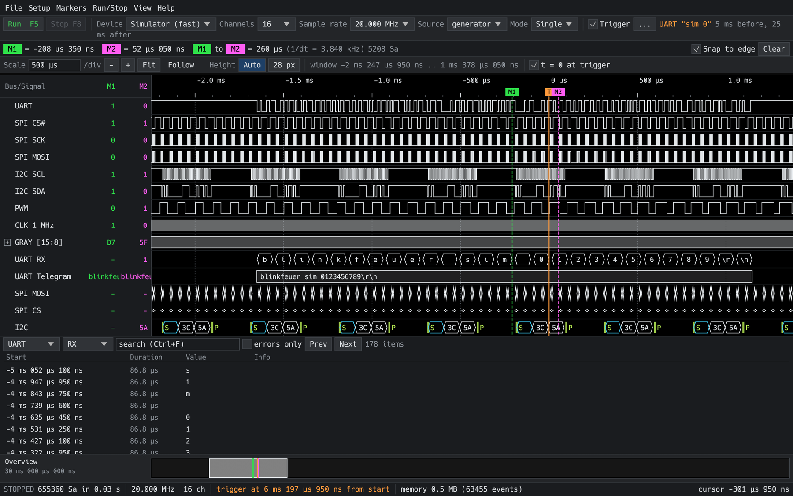

# Blinkfeuer

[](https://github.com/ZeroMips/blinkfeuer/actions/workflows/ci.yml)

A logic analyzer application for Linux, written in Rust. It looks and works like a bench instrument
(black plot, dotted graticule, markers with `M1 to M2` readouts, a Bus/Signal tree) rather than like a
phone app, and it is built for long captures: the capture store only keeps the samples where something
changes, so quiet signals cost almost no memory.

*Blinkfeuer* is the old German word for a flashing beacon, the light that tells you something is out there.



The screenshot shows a capture of the built-in simulator, triggered on the UART text "sim 0" (the orange **T**), with
the UART characters grouped into a telegram, SPI words, I2C transactions and two markers. The protocol decoder
setup shows the UART settings next to an example of what the decoder expects; the decode table below lists the
telegrams that contain "sim". Times are counted from the trigger. `docs/screenshot.sh` makes it again.

It is made for the [Sipeed SLogic16U3](https://wiki.sipeed.com/hardware/en/logic_analyzer/slogic16u3/slogic16u3.html)
(16 channels, USB 3), and has a simulator so you can try everything without hardware. Cheap 8 channel FX2
analyzers (the "Saleae Logic" clones) work too, with sigrok's open fx2lafw firmware.

## Status

A working first version. What is verified and what is not:

- **Simulator**: everything below works on it, and most of it is covered by tests.
- **SLogic16U3 with the stock firmware**: acquisition has been run on hardware at full rate with the
  analyzer's own test patterns, with exact sample counts. **Not yet tried with real probe signals.**
- **LiteX gateware backend** (the open gateware for the same hardware, `bfcli --device litex`, selectable in the
  application when the analyzer runs it): runs on the real device, with the analyzer's test patterns only (no
  probe signals yet). It needs a gateware with the Link Commands fix
  ([usb3_pipe#214](https://github.com/enjoy-digital/usb3_pipe/pull/214)); without it streams die at a few MB/s.
  16 channels at 100 and 200 MHz (up to ~400 MB/s), 8 channels at 400 MHz and 4 channels at 800 MHz were
  captured through the whole application, the raw stream is exact in most runs. **Known problems**: the
  gateware's 16 KB FIFO is sensitive to host jitter at full rate (an occasional "device FIFO overflow", which
  is reported as an error, never as silent data loss), 16 channels at 160 MHz fail in about 40% of the runs
  (under investigation), and one USB 3 port of the test machine does not work with any firmware. Transfers are
  kept small (512 KiB, up to 24 in flight) to stay within Linux's default `usbfs_memory_mb` of 16.
- **FX2 analyzers with fx2lafw** (`bfcli --device fx2lafw`, selectable in the application when one is attached):
  8 channels, 20 kHz to 24 MHz, no threshold and no test patterns. Used on a Saleae Logic clone with real
  signals (UART / Modbus RTU at 16 MHz, also through usbipd under WSL). blinkfeuer loads the firmware itself
  from sigrok's firmware directory, so install it first (Debian/Ubuntu: `sigrok-firmware-fx2lafw`; or set
  `BLINKFEUER_FIRMWARE_DIR`). The firmware cannot report lost data: when the host falls behind, the
  capture silently has a gap.
- Linux only.

## Features

- **Live view** with zoom (at the pointer), pan, follow mode and an overview strip. Scale is given in
  time per division, with times shown in groups ("10 ms 000 µs 400 ns"). F5 runs, F8 or Shift+F5 stops.
- **Markers** M1 and M2 that snap to edges, with their delta and 1/dt; per-row values at the markers.
  The cursor keys move M1 (Shift: M2) from edge to edge of the selected row, or from item to item on a
  decoder row; Up/Down select the row, Home or F shows the whole capture.
- **Bus/Signal setup**: names, 16 trace colors, buses with hex/decimal/binary values, collapsible groups,
  drag and drop reordering, hiding rows. Decoders can sit inside groups.
- **Protocol decoders** for UART, SPI and I2C, written to be fast (cost proportional to the number of
  edges, not samples), with a setup screen that shows example traces for the chosen settings. UART
  characters are also grouped into readable telegrams, and the UART baud rate and frame format (data
  bits, parity, stop bits) can be detected from the capture (also in the trigger setup).
- **Modbus RTU** on top of the UART decoder: frames found by the pause between them and checked by their
  CRC (also when a device answers too fast), each frame split into address, function, registers,
  values and CRC, with requests and responses told apart where the function allows it.
- **Decode table** of the decoded items; clicking in the table moves the waveform and vice versa. The
  search takes text or a pattern in the trigger language below: on characters, words or I2C events it
  lists every item of a match, telegrams and Modbus frames are listed when they contain one.
- **Triggers** (done on the host, the analyzer has none in hardware): level and edge conditions on any
  channels, or a protocol trigger with a pattern:
  - UART text or bytes, SPI words, or I2C events (S, Sr, P, @50W addresses, data bytes, ! for NAK);
  - X for free nibbles or bits (`4X`, `XX`, `0b1010XXXX`) and `*` for anything in between, e.g.
    `S @50W 01 XX P`;
  - optionally also firing on the protocol's error (UART framing/parity error, incomplete SPI word,
    I2C NAK);
  - with Modbus RTU in the UART settings the pattern applies to whole frames from their first byte
    (`65 06 01 01`), or to frames with a bad CRC.

  A protocol trigger can take its decoder settings from a decoder ("Settings from"), so they are set
  only once, and the trigger window shows an example of what it looks for with the trigger point
  marked. The trigger point is the start or the end of the match. Pre-trigger and post-trigger are set
  separately in samples or time, times can be shown relative to the trigger, and a triggered capture
  stops instead of dropping data when memory is full.
- **Measurements** (View menu): edges, frequency, period, duty cycle and the shortest, mean and longest
  high and low pulse of every shown channel, over the visible window, between the markers or over the whole
  capture; copy as CSV.
- **Files**: capture files (`.bfc`, compact and checksummed), setups, VCD export, CSV export of decoded
  items, and import of sigrok session files (`.sr`, from PulseView or sigrok-cli; also `bfcli import`).
  The setup is also kept between runs.

## Build and run

You need Rust 1.88 or newer (`rust-version` of the workspace; the dependencies need it).

```sh
cargo run --release -p bf-app --bin blinkfeuer              # the application
cargo run --release -p bf-app --bin blinkfeuer -- --demo    # a capture of the simulator right away
cargo run --release -p bf-app --bin bfcli -- --help         # command line capture and checks
cargo test --workspace
```

To get the icon in the task bar and the application in the menu, install a desktop entry and the icon,
pointing at the binary you run it from. For your user (into `~/.local/share`):

```sh
target/release/blinkfeuer --install-desktop
```

WSLg only reads desktop entries from the system folders, so under WSL install them there instead:

```sh
sudo target/release/blinkfeuer --install-desktop=/usr/local/share
```

Under WSL blinkfeuer opens its window over X11 (XWayland), where the window shows its own icon; with
Wayland, WSLg's compositor crashed now and then once the desktop entry was installed (all WSL windows go
away with it). `BLINKFEUER_WAYLAND=1` keeps Wayland.

To use the analyzer without root, install the udev rule and replug it:

```sh
sudo cp udev/99-blinkfeuer.rules /etc/udev/rules.d/
sudo udevadm control --reload && sudo udevadm trigger
```

An FX2 analyzer reconnects when blinkfeuer has loaded its firmware: a Saleae Logic clone keeps its ID
`0925:3881`, generic FX2 boards come back as `1d50:608c` (the rule covers both). Under WSL keep
`usbipd attach --wsl --busid <BUSID> --auto-attach` running, so the analyzer is attached again after the
reconnect.

The stock firmware only enumerates over a SuperSpeed (USB 3) link, so use a USB 3 port and cable. If the
analyzer does not show up on a port that worked before, rebinding the host controller has fixed it.

## Layout of the code

| Crate | What it holds |
|---|---|
| `bf-core` | Sample formats, the capture store (sparse change events plus per-block summaries), trigger conditions |
| `bf-device` | The device interface, the simulator, the stock-firmware, LiteX-gateware and fx2lafw backends, the capture session with the trigger logic |
| `bf-decode` | UART, SPI and I2C decoders, Modbus RTU on top of UART, baud rate and frame format detection, the decoding engine, the pattern language shared by protocol triggers and search |
| `bf-io` | Capture file format and VCD export |
| `bf-app` | The application (`blinkfeuer`) and the command line tool (`bfcli`) |

The protocol of the stock firmware is implemented from Sipeed's written description in the
[SLogic repository](https://github.com/sipeed/SLogic); no code was taken from their GPL-licensed driver.
The LiteX backend follows the register map and transport of the gateware's own BSD-2-Clause library
(libslogic16u3, Enjoy-Digital).
The fx2lafw backend talks the command set of sigrok's fx2lafw firmware (three vendor requests and a bulk
endpoint) and the FX2's built-in firmware loader; no libsigrok code is used. The GPL-licensed firmware is
not distributed with blinkfeuer, it is loaded from the system at runtime.

## Licence

Dual licensed under [MIT](LICENSE-MIT) or [Apache 2.0](LICENSE-APACHE), at your option.
